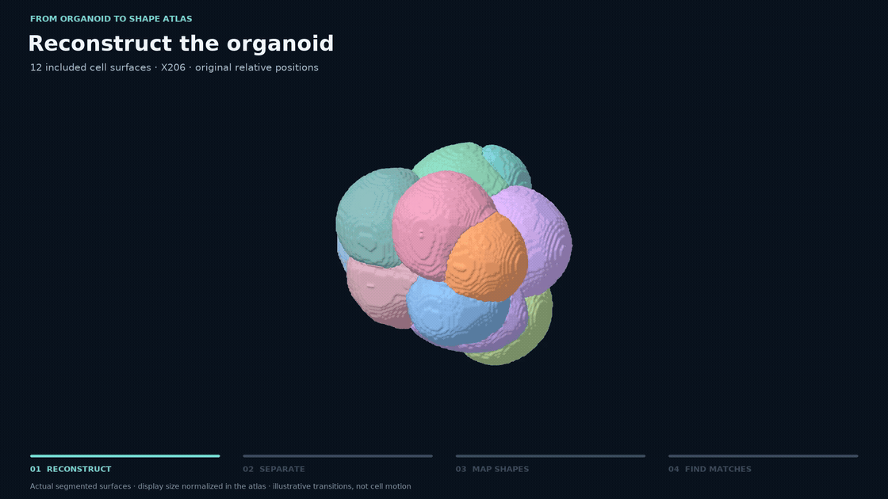
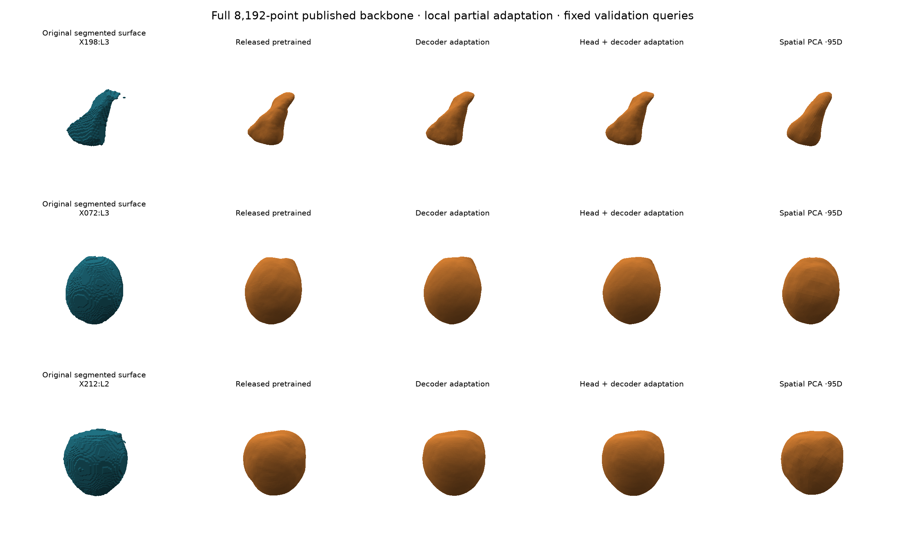
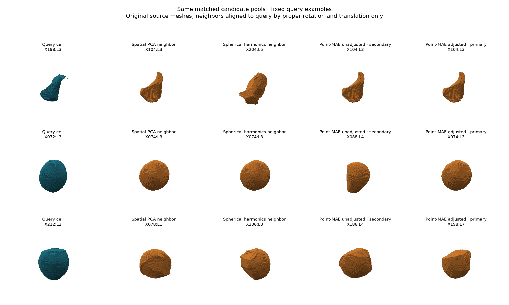
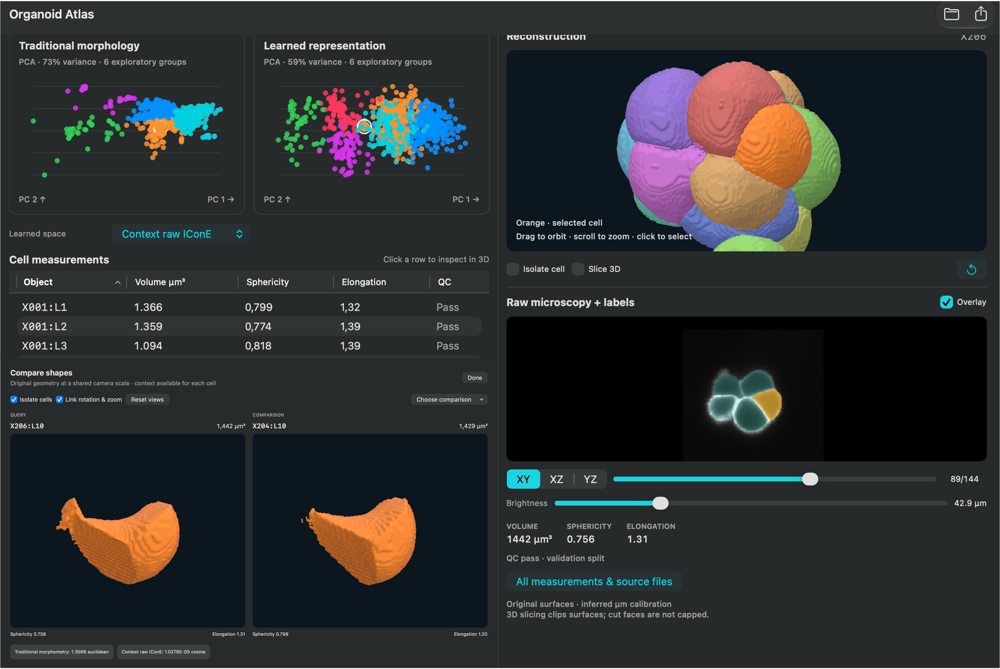

# Organoid Atlas - Interactive visualization and exploratory analysis of 3D cell morphology

Native macOS visualization and exploratory analysis of smaller 3D organoid and cell datasets, with linked microscopy, shape comparisons and scientific rendering workflows. Supporting experiments compare segmentation, classical morphometry and learned representations. **108 stacks · 1,088 segmented cells** from [Mouse-Organoid-Cells-CBG](https://github.com/juglab/EmbedSeg/releases/tag/v0.1.0).

One reconstruction → a 191-cell preview of a 744-cell shape atlas → three nearest matches. Original surfaces, illustrative motion. [MP4](docs/figures/organoid_to_shape_atlas.mp4) · [Traditional vs spatial UMAP rotation](docs/figures/rotating_morphology_umap.gif) · [All 744 cells rotating](docs/figures/rotating_morphology_umap_all_cells.mp4)

## Reconstructing individual cells

Original surfaces (blue), Allen Institute VN-DGCNN/SDF reconstructions and a compact spatial PCA baseline (orange). Local decoder adaptation raised mean surface F1 from **0.829 to 0.856** on 48 validation cells, at a tolerance of 5% of the common radius. Better reconstruction did not make it the best shape-retrieval method.

## Tests and main results

| Experiment | Main finding |
| --- | --- |
| Cellpose-SAM + u-Segment3D | Reconstructed individual cells across 108 microscopy stacks; extracted volume, sphericity, elongation and other measurements. |
| [Raw-image SimCLR / IConE](docs/REPORT.md) | Captured size and multicell context; stricter follow-ups did **not** show a consistent advantage over untrained encoders. |
| [PointNet++ → 128D → point cloud](docs/POINTNET_SHAPE_BASELINE.md) | Learned broad shapes, but lost distinctive details and showed weak rotation stability. |
| [Spatial SDF encoding](docs/SPATIAL_SDF_EXPERIMENT.md) | Improved geometry; a simple 95D spatial PCA beat the tested 128D CNN on reconstruction. |
| [Spherical harmonics / CAJAL](docs/HARMONICS_CAJAL_COMPARISON.md) | Adjusted harmonics reduced neighbor geometry cost by **10.9%** versus nine-feature morphometry; CAJAL did not improve it. Spatial PCA remained strongest at **14.4%**. |
| [Allen VN-DGCNN / SDF](docs/ALLEN_REFERENCE_BENCHMARK.md) | Strong surface reconstruction and rotation stability; limited head/decoder adaptation did not lead retrieval. |
| [Point-MAE](docs/POINT_MAE_BENCHMARK.md) | Adapted pose-averaged features reduced neighbor cost by **12.1%** before adjustment; the advantage weakened after controlling for volume, elongation and sphericity. |
| [ShapeEmbedLite3D prototype](docs/SHAPEEMBED_LITE_3D.md) | Unofficial distance-matrix adaptation: rotation/reflection-invariant descriptors, but sparse reconstructions still underfit cell geometry. |

Neighbor-cost comparisons use 46 matched queries from 48 validation cells, with candidates from other image-similarity groups. These are exploratory geometry results, not phenotype-classification scores. No experimental-condition labels are available; added biological information beyond morphometry remains unproven.

## Which cells look alike?

Blue: query. Orange: each method’s nearest segmented cell, aligned for display by rotation and translation only. Examples are fixed across methods; the table summarizes the broader comparison.

## Explore the results

**[Organoid Atlas](native/OrganoidExplorer/README.md)** is the native macOS viewer and organizer for these experiments: linked plots, tables, raw slices, 3D surfaces and side-by-side shape comparisons. It also provides segmentation trials with Cellpose models, PanSeg and FOCUS-3D.

Example viewer screenshot; plot groups are exploratory, not biological classes.

## Segmentation across Macs

Use a second Apple Silicon Mac as an **Atlas Worker** on the same network. Pair it once through **New Dataset → Processing Macs → Nearby Macs…**; Bonjour discovers workers and Dask distributes whole stacks or Cellpose plane batches from one large stack. Each Mac processes one job at a time, and Atlas collects the results into one dataset. In batch mode, preprocessing and whole-volume u-Segment3D linking still run on the main Mac; RAM is not pooled. [Setup and limits](docs/ATLAS_WORKERS.md).

[Reproduce the pipeline](docs/REPRODUCIBILITY.md) · [Original experiment report](docs/REPORT.md) · [Data and artifacts](docs/DATA.md) · [Full-data representations](docs/ATLAS_FULL_DATA_SHAPES.md)

Code, configurations, tests and selected figures are included. Raw stacks, masks, model weights and large outputs stay outside the repository. Physical calibration is inferred; independent biological specimen identities are unavailable.
