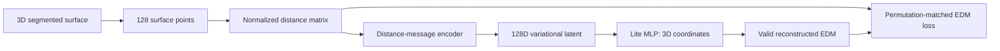

# ShapeEmbedLite3D: experimental surface adaptation

This is an **unofficial research adaptation**, not a published 3D implementation
or an Atlas integration. The author implementation is the primary basis:

- [ShapeEmbedLite](https://github.com/uhlmanngroup/ShapeEmbedLite), commit
  `df178ec4623f59e3a1eb2f37ed46e84e4ff0e22c`, MIT, Uhlmann Group.
- [ShapeEmbedLite paper](https://openaccess.thecvf.com/content/ICCV2025W/BIC/html/Romero_A_comparison_of_data-driven_shape_quantification_methods_for_2D_microscopy_ICCVW_2025_paper.html).
- [ShapeEmbed methodology](https://arxiv.org/abs/2507.01009).

## Method fidelity

The key choices remain distance-matrix representation, variational compression,
coordinate decoding through the **actual Lite DecoderMLP class**, and learning
from reconstructed distances. It does not use PointNet/Point-MAE features,
microscopy intensities, PCA coordinate supervision, Chamfer training losses or
handcrafted morphology inputs.

| Component | ShapeEmbedLite | Experimental 3D version |
|---|---|---|
| Object | Ordered 2D boundary | Unordered 3D surface sample |
| Input | Euclidean distance matrix | Same, 128 surface points |
| Scale handling | Frobenius normalization times N | Same |
| Encoder | Modified ResNet18 | Literal ResNet18 reference; new permutation-equivariant scalar EDM encoder |
| Bottleneck | Variational descriptor | 128-dimensional mean / log variance |
| Decoder | MLP coordinates → EDM | Same source class with three coordinates |
| Reconstruction | EDM discrepancy under cyclic/reversal reindexing | Actual EDM MSE after approximate hard one-to-one surface-point reindexing |
| Inference | Latent descriptor | Deterministic latent mean; scale kept separately |



## Why the encoder and index matching change

The 2D contour has a traversal order. Changing its origin or direction corresponds
to a small cyclic/reversal permutation group. A surface does not have that order;
reusing contour shifts would not provide arbitrary point-index invariance.

The main encoder consumes scalar distances, expands them with 32 distance RBFs
(centers 0–4, width 0.15 in normalized distance units), passes equivariant messages
between distance-graph nodes, and pools symmetrically. LayerNorm operates over
feature channels. Point coordinates, global axes and point indices never enter
this encoder. It is invariant under simultaneous EDM row/column permutations, but
is not claimed to be a complete invariant for all possible metric graphs.

The companion CNN arm reuses the official unpretrained ResNet18 factory with
`padding=False`, retaining the source factory's pooling. It has no guaranteed
arbitrary-permutation invariance. Both arms use the same VAE heads, decoder class,
training data and EDM-matching objective. This is a literal neural-encoder
reference, not an unmodified reproduction of the 2D contour algorithm.

The decoder uses the source class's default three-hidden-layer recipe (widths
become 1,536 with 128 points in 3D), rather than the CLI's wider five-layer recipe.
The latent is explicitly 128D, following the paper's target; the upstream CLI's
experimental internal doubling of its nominal latent-size argument is not used.
Three-dimensional output coordinates guarantee a rank-at-most-three centered
Euclidean Gram matrix. Direct pairwise distance evaluation avoids the numerical
nonzero diagonal that a matrix-multiplication distance kernel can produce.

## Permutation-matched EDM reconstruction

Input and decoded points are compared **only through their pair distances**.
The target is a generalized version of the original index-invariant objective:

`min over point correspondences: mean((D_decoded - permuted(D_input))²)`.

Arbitrary matching uses a Gromov–Wasserstein proposal; it is not an exact
quadratic-assignment/permutation optimum. Initialization uses sorted per-point
distance profiles. Entropic block updates use epsilon 0.03, 0.01 and 0.003, three
iterations each, with 40 log-Sinkhorn balancing steps.

Finite balancing can leave unacceptable marginal errors. Couplings are therefore
rounded into the feasible uniform-marginal transport polytope by marginal capping
and a residual outer-product correction. The resulting plan is projected into a
one-to-one permutation with Hungarian matching. A second candidate is obtained by
Hungarian matching of distance profiles. The candidate with lower actual reindexed
EDM MSE is selected. **Only that hard-reindexed EDM MSE trains the model**; soft
couplings do not average away difficult points. Gradients stop through the matching
solver. No coordinate alignment is used inside the training objective.

Approximate assignment can still miss an optimal correspondence. Identical-input
and independent-sampling reference scores are calibration diagnostics, not general
optimality guarantees or mathematical lower bounds. Feasible soft proposal
marginals and hard assignment definitions are checked in unit tests; final
reconstruction assignments have uniform marginals by construction.

The stated VAE objective uses one reconstruction term plus beta times the mean
per-cell KL term (`beta=1e-10`). The upstream script adds its reconstruction term
twice; that duplication is not reproduced. Log variance has a numerical sampling
guard. Both arms initialize log-variance bias to -6 so initial sampling noise does
not overwhelm mean-code variation. Variational sampling and KL remain enabled.

## Data and experimental protocol

- Same 469 eligible training and 140 validation cells as the prior benchmarks,
  from 21 and 11 disjoint similarity groups. No test or QC-excluded cells.
- Four fixed independent views per cell: choose 2,048 area-sampled candidates,
  then 128 Euclidean farthest points. Sampling uses the geometry-only surface cache
  prepared earlier, not learned Point-MAE representations.
- From-scratch Adam training, 100 epochs, batch 16, learning rate 0.001, seed 42.
  Random view and arbitrary simultaneous row/column permutation each step.
- Checkpoints select deterministic-mean validation EDM reconstruction at epoch 0
  and every fifth epoch. Neighbors, rotations and morphology do not select weights.
- Primary retrieval: invariant 128D descriptor, training-standardized and adjusted
  for log volume, elongation and sphericity versus equally adjusted nine-feature
  morphometry. The original 96 training cells fit scaling and degree-two Ridge.
- Same 48 validation cells / 46 eligible queries / 11 groups and candidate pools
  as the previous studies. Frozen reference weights and geometry costs are reused.
- Resampling and arbitrary-permutation tests cover 48 cells; actual rotation,
  reflection and translation/scaling checks cover the same twelve fixed cells as
  Allen/Point-MAE. Identical-point-set invariance is distinct from sampling stability.

## Development diagnostics

Early probes were isolated before retrieval evaluation. The initial unrounded
coupling could violate uniform row marginals by nearly 100% relative error. A
subsequent scalar-only encoder with default latent noise reconstructed sampled
latents but had nearly constant posterior means on training cells. These findings
motivated feasible transport rounding, distance RBF/channel normalization and the
smaller initial posterior variance. Their weights are not reused in the final
arms. Details and measurements are recorded in `protocol.json`; this development
history reinforces that the experiment is exploratory. A soft-GW training draft
was also isolated when the final objective was tightened to actual reindexed EDM
MSE, which is closer to ShapeEmbedLite's stated loss. Both final arms restart from
the same seed and use that hard-matching objective.

## Interpretation and limits

EDMs remove translation, positive uniform scale and all orthogonal transforms,
including reflection. Thus **chirality is deliberately lost**, as in the original
method. Reflection invariance must not be described as proper-rotation-only
invariance. No topology or closed-mesh reconstruction is guaranteed by 128 points.

Decoded clouds depend only on the latent code. Recorded scale is restored, then
geometry is aligned for evaluation using proper-rotation-only ICP and separately
O(3) ICP permitting reflection; scale is never fitted. Dense source samples and a
128-point source-sampling reference expose the output-resolution limitation.
These point-cloud metrics are not presented as equivalent to dense SDF-mesh F1.

Segmentation-derived geometry is the target, not independent ground truth. There
are no experimental-condition or phenotype labels. Validation selects weights and
also measures retrieval; group bootstrap intervals are descriptive and uncorrected
for multiple readouts. Architecture and external-pretraining budgets differ from
the reference models. No claim of additional biological information follows from
good reconstruction or geometric neighbor matching alone.
Training and evaluation here concern individual cells; whole-organoid shape
analysis would require separate validation of the same prototype.

## Reproduction

The official source in `.cache/shapeembedlite-official`, its pinned commit, existing
geometry caches and configured local Python environment are required:

```sh
.venv/bin/python -m unittest discover -s tests -p test_shapeembed3d.py -v
.venv/bin/python scripts/run_shapeembed3d.py
```

After training, embed a new native Atlas mesh or an `N x 3` NumPy point cloud:

```sh
.venv/bin/python scripts/embed_shapeembed3d.py path/to/cell.mesh --output results/new_cell_lite3d.npz
```

The export contains the raw 128D posterior mean, log variance, sampled input,
normalized EDM and global decoded points in input units. Decoded orientation and
reflection are arbitrary; these are not registered surface meshes. The CLI does
not apply nuisance adjustment, which additionally requires conventional cell
measurements and the training-fitted adjustment model.

The runner resumes five-epoch checkpoints with optimizer and CPU/Metal RNG states.
Data, protocol, models and analysis caches are hash-bound. Results are written only
to `results/shapeembed3d/`. Native Atlas sources and exports are left untouched.
