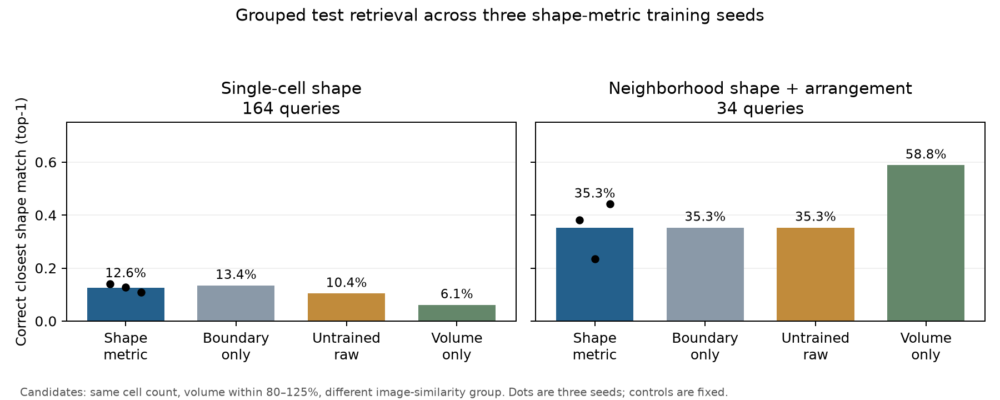

# Shape-aligned raw 3D representation experiment

The completed [boundary-aware experiment](BOUNDARY_SHAPE_EXPERIMENT.md) reduced dense prediction loss but did not improve matched 3D shape retrieval over an untrained encoder. This follow-up tests whether directly training the global embedding against the evaluated shape geometry changes that result.

## Controlled comparison

The model uses the **same 96³ raw-image crops, 128-dimensional encoder architecture, and image-similarity-grouped split** as the boundary-aware run. Existing raw volumes and predicted Cellpose/u-Segment3D labels are reused without duplicating the 7 GB preparation. The supplied reference annotations are excluded. The encoder's inference input remains raw intensity alone, while its training targets are computed from predicted cell masks; therefore this is *segmentation-guided* learning rather than fully annotation-free self-supervision.

For each predicted cell, five morphology measurements are standardized using training cells only: sphericity, aspect ratio, elongation, flatness, and mesh solidity. For multicell fields, each descriptor is sorted across cells to form a permutation-invariant set representation, and sorted pairwise centroid distances are RMS-normalized to represent relative arrangement. Shape and arrangement contribute equal weight to the combined multicell target. The embedding loss matches the within-batch neighbor distribution of these targets. The existing dense boundary losses remain auxiliary, with smaller weights, and photometric-view consistency remains active. This change acts **directly on the pooled embedding**, unlike the earlier dense losses that the decoder could potentially solve using skip connections.

Three seeds run sequentially. Each seed selects its checkpoint by the mean validation rank percentile for **single-cell shape** and **neighborhood combined shape-plus-arrangement** retrieval. Whole-stack fields are omitted from checkpoint selection because too few matched validation queries exist. The held-out test is evaluated only after each seed finishes. Each evaluation compares the new model with the *same existing boundary-only checkpoint*, an identical untrained encoder, and a volume-only ranking on identical candidates. Candidates have the same cell count, foreground volume within 80–125% of the query, and belong to a **different image-similarity group**; this is stricter than the earlier different-stack filter and all controls are re-scored under it. Test output separately reports single-cell shape; neighborhood shape, arrangement and combined; and whole-stack-field shape, arrangement and combined. Whole-stack fields should not be interpreted as confirmed biological organoids.

The prior test aggregate has already informed this design, so this reused grouped test is an **exploratory controlled comparison**, not a fresh confirmatory holdout. Pixel-aligned TIFF correlation grouping is a proxy for acquisition/specimen identity; independent biological generalization still needs specimen IDs or new samples. A within-dataset gain would require the new model to outperform both the boundary-only and untrained controls consistently across seeds and image-similarity groups, especially for single-cell shape and multicell combined retrieval. The three seeds address initialization variability but do not create three independent biological datasets.

## Completed evaluation · 25 September 2026

All three 20-epoch runs completed. Retrieval-based validation selected checkpoints at epochs **1, 17, and 19**, respectively. The metric training loss decreased in every run, but that did not translate into a consistent held-out retrieval gain. The table shows top-1 matches on identical queries and candidates; the new model's entry is the mean and range across the three seeds, whereas each control is fixed.

| Retrieval target | Queries | Shape-metric raw | Boundary-only raw | Untrained raw | Volume only |
|---|---:|---:|---:|---:|---:|
| Single-cell shape | 164 | **12.6%** (11.0–14.0%) | 13.4% | 10.4% | 6.1% |
| Neighborhood shape + arrangement | 34 | **35.3%** (23.5–44.1%) | 35.3% | 35.3% | **58.8%** |
| Neighborhood arrangement alone | 34 | 38.2% (32.4–41.2%) | 41.2% | 44.1% | 35.3% |

The new model ranks single-cell morphology matches somewhat better than boundary-only on average (mean rank percentile **0.696 vs 0.634**) but worse than the untrained raw encoder (**0.715**). Its mean single-cell morphology distance is **0.795**, versus **0.897** for boundary-only and **0.767** for untrained. For neighborhood shape plus arrangement, the new model's mean target distance (**0.429**) is lower than boundary-only (**0.621**) and approximately tied with untrained (**0.436**), but volume-only is lower still (**0.387**). These mixed measures do not establish better shape retrieval from training.

Paired comparisons average the three new-model seeds *within each query* before a two-sided exact sign-flip calculation across image-similarity groups. On single-cell top-1 accuracy, the differences from boundary-only and untrained are −0.8 and +2.2 percentage points, with group-level p=0.938 and p=1.000. On neighborhood combined top-1 accuracy, the differences from those controls are both approximately zero (p=1.000 and p=0.750). The neighborhood deficit relative to volume-only is **23.5 points** (p=0.016 across eight groups). These p-values are exploratory: the same dataset informed the design, multiple endpoints were examined, and 34 neighborhood queries come from only eight groups.

The volume-only result shows that residual size still supplies a strong cue even after limiting candidates to 80–125% of query volume. The query-specific random-choice top-1 expectation is **3.1%** for single cells and **23.9%** for neighborhoods, so several raw methods carry information, but their advantage cannot be attributed to this training objective. Neighborhood candidate sets are small (median four), so a moderate cue can dominate top-1 accuracy. Only **four** whole-stack-field queries remained after requiring a different similarity group; their scores are too sparse to interpret. None of these fields is confirmed to be an independent biological organoid.

**Conclusion:** replacing the axis-ratio-dominated training target with five shape descriptors and multicell arrangement did **not** solve the representation problem. A direct embedding loss was insufficient to consistently outperform raw architectural features, and this benchmark cannot justify a claim of learned, size-independent 3D shape retrieval. The next useful diagnostic is a same-split mask-input upper bound paired with a direct raw-image shape prediction probe. If masks perform well but raw images do not, inspect crop alignment, image resolution/contrast, and segmentation-target fidelity before adding more contrastive training. Independent specimen metadata or newly collected organoids remain necessary for biological generalization.



Public aggregate [test scores](tables/shape_metric_test_summary.csv) and [paired comparisons](tables/shape_metric_paired_comparisons.csv) can be regenerated with `.venv/bin/python scripts/report_shape_metric.py`. The per-query records and checkpoints remain in ignored `results/shape_metric/`.

## Run and monitor

From the repository root:

```bash
.venv/bin/python scripts/prepare_shape_metric.py
.venv/bin/python scripts/start_shape_metric.py
tail -f results/shape_metric/pipeline.log
```

The launcher resumes incomplete checkpoints and runs seeds listed in [`config/shape_metric.json`](../config/shape_metric.json). Current overall status is in `results/shape_metric/pipeline_status.json`; epoch-level status and `training_history.csv` are in `results/shape_metric/seed_<number>/`. Query-level results, summaries, and exact group-level paired sign-flip comparisons are written beside each seed's checkpoints. To run one seed in the foreground on CPU for debugging:

```bash
.venv/bin/python scripts/train_shape_metric.py --seed 20260924 --device cpu
```
